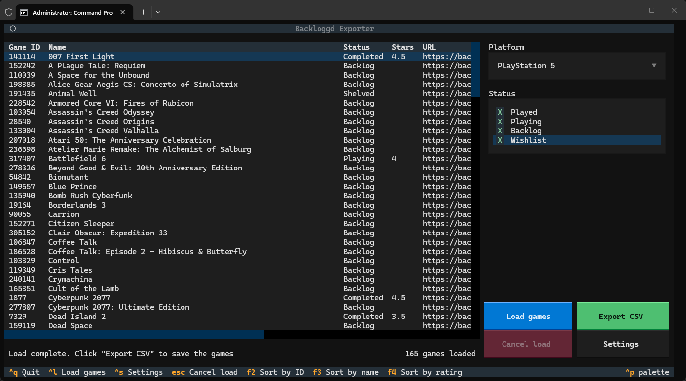

# Backloggd Exporter
A lightweight, easy-to-use terminal-based alternative for exporting your games from Backloggd to a CSV.



## Features
- Terminal-based UI powered by Textual
- Preview data before export with an interactive table (data can be sorted by ID, name or rating)
- Export a game list to a CSV, including basic game data and log status

## Installation
1) Download the repo and install requirements:
```bash
pip install -r requirements.txt
```

2) Acquire your cookies.txt file

Login to Backloggd and use an extension to grab the needed cookies (these are used to navigate Backloggd's firewall and process your data). You can use any extension that will export to a Netscape compatible `cookies.txt`, such as [this](https://chromewebstore.google.com/detail/get-cookiestxt-locally/cclelndahbckbenkjhflpdbgdldlbecc?hl=en) (Chrome) or [this](https://addons.mozilla.org/en-GB/firefox/addon/get-cookies-txt-locally/) (Firefox). Cookies are not used in any way other than to give you access to your data.

3) Edit the config.json file

- Rename the `config.example.json` file to `config.json`
- Here you can set defaults for the application:
    - username - add your username here
    - cookies - add the full path to your cookies file for step 2 (including file name and `.txt`)
    - platform - optional - add a default platform. such as `"ps3"`. A full list of platform slugs is available in `data\platforms.json`
    - statuses - optional - customise the default statuses (can be a mix of "played", "playing", "backlog", "wishlist")
    - output - optional - directory to save CSV file in. Uses working directory if not specified

## Usage
Run with:
```bash
python backloggd.py
```
- Set the platform and statuses as necessary
- Click `Load games` (or CTRL+L) - the app will start scraping Backloggd's game cards, which are HTML fragments wrapped in [Turbo Stream](https://turbo.hotwired.dev/handbook/streams) elements. This works a lot like a paginated API, and the app will keep scraping until a page returns nothing.
    - Cookies from an active login are required to access your log data - without these, the HTML only provides game name, ID and cover information
- Once the load completes, a preview of the data will appear in the table, showing the game's ID, name, logged status, star rating and URL
- Click `Export CSV` - this will save the full CSV file to the specified directory
- Use the `Settings` menu to set username, cookie file location or save directory at any time

### CSV fields
- `game_id` - a game's IGDB ID
- `title` - game title
- `url` - link to game's Backloggd page
- `platform_filter` - taken from the platform selection - exports using "Any platform" will be null for this field, as the HTML doesn't include the game's platform
- `statuses` - the statuses the game is marked with (playing, played, backlog, wishlist). This is a list, rather than the latest status.
- `raw_rating` - score given to the game within the log
- `status_title` - same as `played_status` - extra description of status (e.g. 'shelved' or 'completed')
- `log_id` - Backloggd's log identifier
- `is_played` / `is_playing` / `is_backlog` / `is_wishlist` / `is_liked` - true if yes, false if no
- `played_status` - same as `status_title` - extra description of status (e.g. 'shelved' or 'completed')
- `played_timestamp` / `playing_timestamp` / `backlog_timestamp` / `wishlist_timestamp` / `liked_timestamp` - timestamp for when action was logged
- `rating_stars` - `rating_raw` divided by 2, to represent the star value (e.g. 9/10 is 4.5 stars)
- `display_status` - latest status for each game, uses the latest status from `statuses` OR `status_title`


